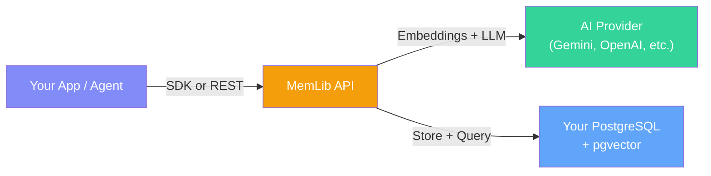
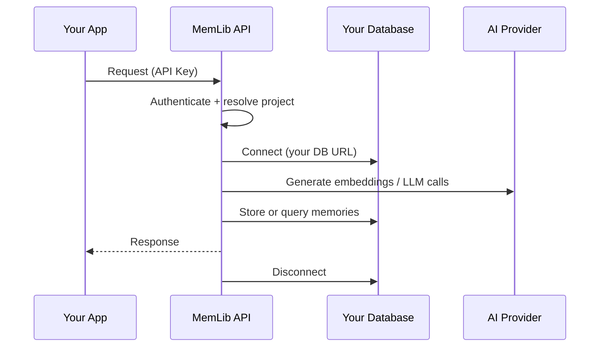

## Overview

MemLib is a **memory API** that sits between your AI application and your own infrastructure. You bring your own database and AI provider keys — MemLib orchestrates the memory pipeline.

### What MemLib Does

1. **Extracts facts** from natural language using LLM inference
2. **Embeds** each fact into a vector for semantic search
3. **Deduplicates** against existing memories via cosine similarity
4. **Resolves conflicts** when new information contradicts old (e.g., "moved from NYC" → "lives in Berlin")
5. **Retrieves** memories by meaning with hybrid scoring
6. **Synthesizes** context paragraphs tailored to the current conversation

### What You Provide

| You Provide | Why |
|-------------|-----|
| **PostgreSQL database** (with pgvector) | Your data stays in your infrastructure |
| **Embedding provider** API key | For converting text → vectors |
| **LLM provider** API key | For fact extraction, conflict resolution, and synthesis |

This is the **Bring Your Own Database (BYOD)** model. MemLib never stores your data — it connects to your database at request time and runs the memory pipeline.

---

## Request Lifecycle

Every API call follows the same pattern:

Key details:
- **Authentication** — every request requires an API key (`Authorization: Bearer sk_...`)
- **Project isolation** — each API key maps to a project with its own database URL and AI provider config
- **Stateless** — the API connects to your database per-request and disconnects after

---

## Components

MemLib is composed of several layers:

| Layer | What It Does |
|-------|-------------|
| **SDK** (`memlib` on npm) | TypeScript client with typed methods for store, recall, prepare, diff |
| **REST API** | HTTP endpoints under `/v1` with API key auth and OpenAPI schema |
| **MCP Server** | Model Context Protocol server — lets Claude, Cursor, and other MCP clients use your memories directly |
| **Memory Engine** | The core pipeline: fact extraction, embedding, deduplication, conflict resolution, consolidation |
| **Dashboard** | Web UI for creating projects, managing API keys, browsing memories, and testing recall |

---

## Data Model

Memories are stored in two tables in your PostgreSQL database:

### `memories` table

Each row is an atomic fact with its vector embedding:

| Field | Description |
|-------|-------------|
| `id` | UUID primary key |
| `namespace` | Project/tenant scope (e.g., `"my-app"`) |
| `entity` | Entity within the namespace (e.g., `"user-123"`) |
| `content` | The memory text |
| `embedding` | 1536-dimensional vector (pgvector) |
| `importance` | 0.0–1.0 importance score |
| `category` | Auto-assigned category (preference, personal, etc.) |
| `tags` | User-defined tags |
| `archived` | Whether the memory has been consolidated or superseded |

### `memory_events` table

Every mutation is logged as an audit event:

| Event | When |
|-------|------|
| `ADD` | New memory inserted |
| `MERGE` | Two memories combined into a richer one |
| `REPLACE` | New fact superseded an old one |
| `DELETE` | Memory deleted or archived due to contradiction |
| `SKIP_DUPLICATE` | Near-duplicate detected and skipped |
| `KEEP_EXISTING` | Conflict resolved in favor of the existing memory |

This audit trail powers the [diff](/docs/sdk/diff) feature — zero-LLM-cost changelog queries.

---

## Supported Providers

MemLib supports multiple AI providers out of the box:

### LLM Providers (for fact extraction + conflict resolution)

| Provider | Models |
|----------|--------|
| Google Gemini | Gemini 2.0 Flash, Gemini 1.5 Flash, Gemini 1.5 Pro |
| OpenAI | GPT-4o, GPT-4o Mini, GPT-4 Turbo |
| Anthropic | Claude 4 Sonnet, Claude 3.5 Haiku |
| Mistral | Mistral Large, Mistral Small |
| Groq | LLaMA 3.3 70B, Gemma 2 9B |
| xAI | Grok 2, Grok 2 Mini |
| Cohere | Command R+, Command R |
| OpenRouter | Any model via OpenRouter |

### Embedding Providers (for vector search)

| Provider | Models |
|----------|--------|
| Google Gemini | text-embedding-004 |
| OpenAI | text-embedding-3-small, text-embedding-3-large |
| Cohere | embed-english-v3.0, embed-multilingual-v3.0 |
| Mistral | mistral-embed |
| Voyage | voyage-3, voyage-3-lite |

See the [Providers guide](/docs/guides/providers) for detailed setup instructions.

## Next Steps

- [Namespaces & Entities](/docs/concepts/namespaces-and-entities) — understand multi-tenancy
- [Smart Store](/docs/concepts/smart-store) — how the storage pipeline works
- [Quickstart](/docs/quickstart) — get up and running in 5 minutes
