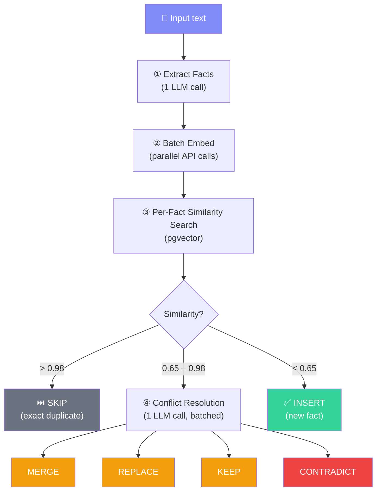

## Two Storage Modes

MemLib offers two ways to store memories:

| Mode | LLM Calls | Best For |
|------|-----------|----------|
| **Smart Store** (`infer: true`, default) | 1–2 | Natural language input — conversations, notes, messages |
| **Raw Store** (`infer: false`) | 0 | Pre-structured facts — data you've already processed |

---

## Smart Store Pipeline

When you store with `infer: true` (the default), MemLib runs a multi-stage pipeline:



### Stage 1: Fact Extraction

A single LLM call parses the input into **atomic facts**, each with an importance score and category:

```
Input:  "I switched from VS Code to Cursor. Love the AI features.
         My team meets every Monday at 10am."

Output:
  ├── { text: "Uses Cursor as primary editor", importance: 0.7, category: "preference" }
  ├── { text: "Previously used VS Code", importance: 0.5, category: "preference" }
  ├── { text: "Values AI-powered development features", importance: 0.6, category: "preference" }
  └── { text: "Team meets every Monday at 10am", importance: 0.8, category: "professional" }
```

### Stage 2: Batch Embedding

All extracted facts are embedded in parallel using your configured embedding provider. The embeddings are 1536-dimensional vectors used for similarity search.

### Stage 3: Similarity Search

For each fact, MemLib queries your database using pgvector to find existing memories with high cosine similarity:

| Similarity | Action |
|------------|--------|
| **> 0.98** | **Skip** — the fact is an exact duplicate |
| **0.65 – 0.98** | **Conflict zone** — semantically similar but not identical. Needs resolution. |
| **< 0.65** | **Insert** — new fact, no overlap with existing memories |

### Stage 4: Conflict Resolution

If any facts land in the conflict zone (0.85–0.95 similarity), a **single batched LLM call** resolves all of them at once:

| Resolution | What Happens | Example |
|------------|-------------|---------|
| **MERGE** | Combine both facts into a richer memory | "Uses TypeScript" + "Prefers TypeScript for backends" → "Uses TypeScript, especially for backend development" |
| **REPLACE** | New fact supersedes old | "Uses VS Code" → "Uses Cursor (switched from VS Code)" |
| **KEEP** | Existing memory is adequate, skip the new fact | "Lives in Berlin" + "Located in Berlin" |
| **CONTRADICT** | Old fact is wrong — archive it, insert the new one | "Loves vanilla ice cream" → "No longer likes vanilla ice cream" |

---

## Cost Analysis

The smart store pipeline is designed for minimal LLM usage:

| Scenario | LLM Calls | Typical Cost |
|----------|-----------|-------------|
| All new facts, no overlaps | 1 (extraction only) | ~$0.001 |
| Some overlaps detected | 2 (extraction + conflict resolution) | ~$0.002 |
| All duplicates | 1 (extraction only, all skipped) | ~$0.001 |

**Maximum 2 LLM calls per store**, regardless of how many facts are extracted. The conflict resolution call is batched — even if 10 facts have conflicts, they're resolved in a single prompt.

---

## Raw Store Pipeline

When you store with `infer: false`, the pipeline is much simpler:

```
Content → Embed → Check similarity > 0.95 → Skip (duplicate)
                                           → Insert (new)
```

No LLM calls. The content is stored exactly as provided. Use this when you already have clean, atomic facts.

---

## Event Logging

Every mutation in the smart store pipeline is logged to the `memory_events` table:

```ts
const result = await mem.store({
  content: "I switched from VS Code to Cursor",
});

// result.memories = [
//   { content: "Uses Cursor as primary editor", event: "ADD" },
//   { content: "Uses Cursor (switched from VS Code)", event: "REPLACE" },
// ]
// result.skipped = 0
// result.conflicts = 1
```

These events power the [diff](/docs/sdk/diff) feature, letting you query exactly what changed over time.

---

## Next Steps

- [Scoring](/docs/concepts/scoring) — how recall ranks memories
- [Categories](/docs/concepts/categories) — the auto-categorization system
- [SDK store() reference](/docs/sdk/store) — full API details
