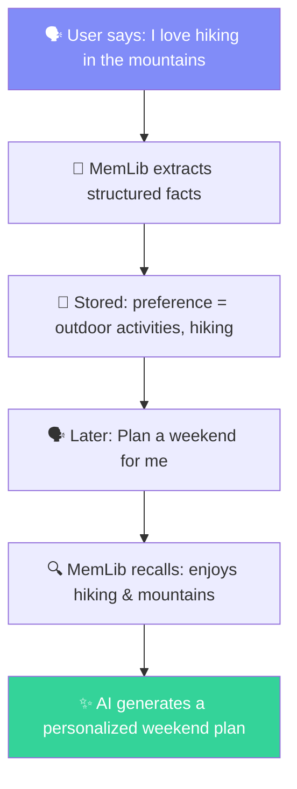

## What is MemLib?

MemLib is an **open-source memory layer** for AI agents and applications. It provides persistent, semantic memory that lets your AI remember context across conversations, sessions, and users.

### Key Features

- **Smart Store** — Extract structured facts from natural language with LLM-powered inference
- **Semantic Recall** — Retrieve memories by meaning, not just keywords
- **Context-Aware Synthesis** — Get a tailored briefing paragraph from relevant memories, ready for your system prompt
- **Namespaces & Entities** — Organize memories per user, session, or any scope
- **Multiple Providers** — Works with OpenAI, Google Gemini, and Anthropic

### How It Works

### Architecture

MemLib is composed of:

| Component | Description |
|-----------|-------------|
| **SDK** (`memlib`) | TypeScript client for your app |
| **REST API** | HTTP endpoints with API key auth |
| **Memory Engine** | Embedding, storage, recall, and consolidation |
| **Dashboard** | Web UI for managing projects, keys, and memories |

## Getting Started

Head to the [Quickstart](/docs/quickstart) guide to set up MemLib in under 5 minutes.
