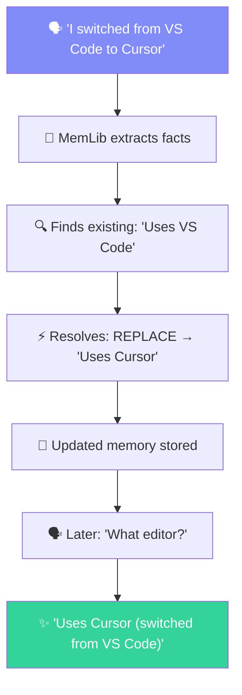

## What is MemLib?

MemLib is an **open-source memory API** that gives your AI agents persistent, semantic memory. Store natural language, and MemLib automatically extracts facts, deduplicates, resolves conflicts, and retrieves memories by meaning — all via a simple SDK or REST API.

**Bring Your Own Database.** Your memory data stays in your PostgreSQL instance. MemLib connects to your database and AI provider at request time — no vendor lock-in, full data ownership.

### Key Capabilities

| Capability | What It Does | LLM Calls |
|------------|-------------|-----------|
| **Smart Store** | Extract facts from natural language, deduplicate, and resolve conflicts | 1–2 |
| **Semantic Recall** | Find memories by meaning with hybrid scoring | 0 |
| **Context Synthesis** | Synthesize a tailored briefing paragraph for your system prompt | 2 |
| **Memory Diff** | Track what changed — new facts, updates, and contraditions | 0 |
| **Consolidation** | Summarize old memories into concise entries | 1 |
| **MCP Server** | Let Claude, Cursor, and other clients use memories directly | — |

### How It Works



### Supported Providers

**LLM:** Google Gemini · OpenAI · Anthropic · Mistral · Groq · xAI · Cohere · OpenRouter

**Embedding:** Google Gemini · OpenAI · Cohere · Mistral · Voyage

### Architecture

| Component | Description |
|-----------|-------------|
| **SDK** (`memlib` on npm) | TypeScript client with typed methods |
| **REST API** | HTTP endpoints with API key auth |
| **MCP Server** | Model Context Protocol for Claude Desktop, Cursor, etc. |
| **Memory Engine** | Embedding, fact extraction, dedup, conflict resolution |
| **Dashboard** | Web UI for project management, API keys, and memory browsing |

---

## Quick Example

```ts
import { MemLib } from "memlib";

const mem = new MemLib({
  apiKey: "sk_...",
  namespace: "my-app",
  entity: "user-123",
});

// Store — extracts facts, deduplicates, resolves conflicts
await mem.store({
  content: "I prefer TypeScript and dark mode. My team uses React.",
});

// Recall — semantic search by meaning
const memories = await mem.recall({
  query: "What tech stack?",
});

// Prepare — synthesize context for a system prompt
const { context } = await mem.prepare({
  messages: [{ role: "user", content: "Help me set up a project" }],
});

// Diff — what changed since last session
const diff = await mem.diff({ since: "2024-01-01T00:00:00Z" });
```

---

## Next Steps

- **[Quickstart](/docs/quickstart)** — get up and running in 5 minutes
- **[How It Works](/docs/concepts/how-it-works)** — architecture and data model
- **[SDK Reference](/docs/sdk)** — full method documentation
- **[MCP Guide](/docs/guides/mcp)** — connect to Claude Desktop or Cursor
